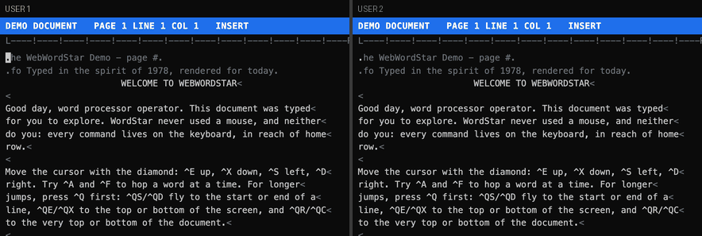
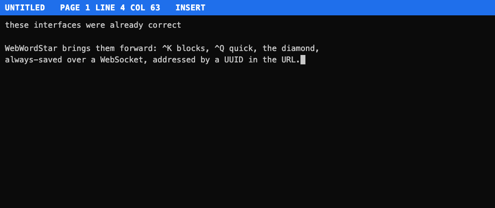

# WebWordStar

[](https://github.com/DDecoene/WebWordStar/actions/workflows/ci.yml)


*The 1978 word processor George R. R. Martin never gave up — in your browser,
with the one feature it never had: other people.*

A clean-room, browser-based reimplementation of **WordStar** for the modern era —
faithful to the original keyboard-first interface (the diamond cursor, `^K` block
commands, `^Q` quick commands), extended with always-saved documents and
**real-time multiuser collaboration** over WebSockets.



*Two people, one document, zero mice: peer cursors with name tags, concurrent
same-line typing that converges, and an undo that only ever reverts **your own**
edits.*

## Try it in one click — no install

[](https://codespaces.new/DDecoene/WebWordStar?quickstart=1)

A Codespace installs the dependencies, starts the dev server, and opens the editor
preview for you.

## Try it in 30 seconds

```bash
npm install && npm run dev    # Node 22+
```

Then open **http://localhost:5273/demo** — a seeded, private showcase document that
teaches the keyboard as you read it. Copy the URL into a second window and type in
both: that's the collaboration above. Everything auto-saves; there is no save command.

## Philosophy

These interfaces were already correct. WordStar's keyboard-driven design let writers
keep their hands on the keys and their attention on the words, and decades of muscle
memory proved how well it worked. We're not replacing that design — we're bringing it
forward, running natively in the browser. The full argument — what WordStar got
right and why it's worth reviving — is in
[the WordStar retrospective](docs/wordstar-retrospective.md).

## What's in the box (v1.0.0, feature-complete)



- **The real WordStar interface** — the diamond (`^E`/`^X`/`^S`/`^D`), `^Q` quick
  movement, `^K` blocks, `^O` onscreen format, `^P` print controls, self-revealing
  menus with help levels, insert/overtype, word wrap + `^B` reflow, multi-level
  undo/redo. Arrow keys work too; purists may ignore them.
- **The terminal look** — blue status bar with `PAGE`/`LINE`/`COL`, ruler line, flag
  column, blinking block cursor, dashed page-break rows from real pagination.
- **Layout dot commands** — `.lm`/`.rm`/`.ls`/`.pl`/`.mt`/`.mb`/`.pa`/`.cp`/`.pn`/`.op`/`.he`/`.fo`,
  folded positionally down the document exactly like 1979.
- **Real-time collaboration** — server-authoritative edit intents with revisions and
  positional transform; peer cursors with `USER n` name tags; concurrent same-line
  edits converge; undo is scoped to your own edits.
- **Always saved** — UUID document URLs over WebSocket + SQLite; no save command,
  no `.BAK` files.
- **Print/export** — PDF, HTML, Markdown, plain text, and native WordStar text via
  `^K P`, honouring `^P` styles and dot-command layout.

See the roadmap in [`CLAUDE.md`](CLAUDE.md) and the [`CHANGELOG.md`](CHANGELOG.md).

**Documents in and out:** `GET /demo` seeds a fresh, private feature-showcase document
and redirects you to it; `^K P` can export the native WordStar-text format (`W`) in
addition to PDF/HTML/Markdown/plain text; `^K R` opens a file picker to import a
document, including real WordStar 3.x/4 files (not just plain text or our own `.ws`).

## Running it

```bash
npm install
npm run dev        # Vite on http://localhost:5273 + the WebSocket server on :5274
```

Open **http://localhost:5273** — you'll be redirected to a document URL like
`http://localhost:5273/?doc=<uuid>`. That UUID is the document's identity: bookmark or
share the URL to return to the same document (sharing it is how you invite a
collaborator); open a fresh URL for a new one.

```bash
npm test               # Vitest unit + integration
npx playwright test    # Playwright end-to-end (browser)
npm run build          # type-check + Vite production build
```

## Deploying

```bash
npm run serve      # vite build, then the Node server serves the assets + WebSocket
```

In production a single Node process serves both the static assets and the WebSocket
endpoint on **port 5274** (set `WS_PORT` to override). Documents live in a SQLite
file under `data/` (created on first run) — back up or persist that directory.
Because collaboration needs a long-lived WebSocket server and a local SQLite file,
host it on something with a persistent Node process and disk (a VPS, Fly.io,
Railway, …) — not a serverless/static platform.

**Know the security model before hosting publicly:** WebWordStar has **no
authentication**. Documents are private-by-URL — the UUID in the URL is the only
access control, and anyone with a document's URL can read *and edit* it. See
[SECURITY.md](SECURITY.md).

### Demo mode (public instances)

For a publicly reachable instance, set `WWS_DEMO=1` to turn on abuse guards
(all off by default, so a private install behaves exactly as before):

| Variable | Default | Effect |
|---|---|---|
| `WWS_DEMO` | unset | `1` enables demo mode (everything below) |
| `WWS_WIPE_HOURS` | `24` | Documents idle longer than this are deleted (checked every 15 min; documents with an open session are never touched) |
| `WWS_CREATE_PER_IP_PER_HOUR` | `30` | Per-IP hourly cap on document-creating requests (`GET /demo`, `POST /import`) |
| `WWS_MAX_CONN_PER_IP` | `8` | Max concurrent WebSocket connections per IP |
| `WWS_MSG_PER_10S` | `400` | Max WebSocket messages per connection per 10 s (exceeding closes the connection) |

Demo mode identifies clients by socket address, so run the Node process directly
exposed or behind a TCP (layer-4) proxy; behind an HTTP reverse proxy all traffic
appears to come from one IP and the per-IP limits will bite everyone at once.

## Keyboard reference

WebWordStar binds commands to `Ctrl`+letter, exactly like WordStar. On non-QWERTY
layouts a few keys are physically displaced (e.g. `^A`/`^Q` on AZERTY); arrow keys are
provided as a modern alternative for cursor movement.

### The diamond (cursor movement)

The four movement keys sit in a diamond under your left hand — up is literally
above down, left is literally left of right:

```
        ^E
    ^S      ^D        (^A word left · ^F word right)
        ^X
```

| Keys | Move | Alternate |
|---|---|---|
| `^E` / `^X` | Up / down a line | `↑` / `↓` |
| `^S` / `^D` | Left / right a character | `←` / `→` |
| `^A` / `^F` | Left / right a word | |

### `^Q` quick movement

| Keys | To |
|---|---|
| `^Q S` / `^Q D` | Start / end of line |
| `^Q E` / `^Q X` | Top / bottom of screen |
| `^Q R` / `^Q C` | Start / end of document |

### `^K` block & document commands

| Keys | Action |
|---|---|
| `^K B` / `^K K` | Mark block begin / end (highlighted) |
| `^K C` | Copy the marked block to the cursor |
| `^K Y` | Delete the marked block |
| `^K H` | Hide / show the block highlight |
| `^K N` | Name the document (inline `DOCUMENT NAME:` prompt) |
| `^K P` | Export (prompt: `P`=PDF, `H`=HTML, `T`=Text, `M`=Markdown, `W`=WordStar) |
| `^K R` | Read (import) a file — opens a file picker |

### Editing

| Keys | Action |
|---|---|
| `^V` | Toggle insert / overtype |
| `Enter` | Split the line |
| `Backspace` / `^G` | Delete left / right (joins lines at edges) |
| `^B` | Reflow (word-wrap) the current paragraph |
| `^U` | Undo |
| `^Q U` | Redo |
| `^K V` | Move the marked block to the cursor |

### `^O` onscreen format

| Keys | Action |
|---|---|
| `^O L` / `^O R` | Set left / right margin (prompt) |
| `^O C` | Center the current line |
| `^O S` | Set line spacing (prompt) |
| `^O J` | Toggle justification |
| `^O W` | Toggle word wrap |
| `^O T` | Toggle the ruler line |
| `^O D` | Toggle print-control display |
| `^O I` / `^O N` | Set / clear a tab stop |
| `^O X` | Release margins |
| `^O G` | Temporary paragraph indent |

### `^P` print controls

| Keys | Style |
|---|---|
| `^P B` | Bold |
| `^P S` | Underline |
| `^P Y` | Italic |
| `^P D` | Double-strike |
| `^P X` | Strikeout |
| `^P T` | Superscript |
| `^P V` | Subscript |
| `^P O` | Non-break space |

### `^J` help

| Keys | Action |
|---|---|
| `^J H` | Cycle help level (0–3, default 3) |

### Dot commands

Lines starting with `.` are layout dot commands; they render dimmed with a `.` flag,
never wrap, and position-override the `^O` ruler from that line down.

| Command | Effect |
|---|---|
| `.lm n` | Set left margin to column `n` |
| `.rm n` | Set right margin to column `n` |
| `.ls n` | Set line spacing |
| `.pl n` | Set page length (default 66) |
| `.mt n` | Set top margin (default 3) |
| `.mb n` | Set bottom margin (default 8) |
| `.pa` | Force a page break |
| `.cp n` | Conditional page break if fewer than `n` lines remain |
| `.pn n` | Renumber the page |
| `.op` | Omit page numbers |
| `.he text` | Set header text (used by the exporter) |
| `.fo text` | Set footer text (used by the exporter) |

## Architecture

- **Browser** — a pure keystroke reducer (`src/editor/state.ts`) over a pure document
  model (`src/shared/document.ts`), an HTML renderer (`src/editor/render.ts`), and a
  `WsClient` (`src/ws/WsClient.ts`) that streams changes to the server.
- **Server** — Node + WebSocket (`server/index.ts`) with a `DocumentSession` per
  connection over a SQLite `DocumentStore` (`better-sqlite3`, WAL).
- **Shared** — TypeScript types and the document model are shared between client and server.

See `CLAUDE.md` for the full architecture, command tables, and roadmap.

## Tech stack

Node.js · WebSockets (`ws`) · SQLite (`better-sqlite3`) · TypeScript · Vite · Vitest · Playwright.

## Contributing

Contributions welcome — see [CONTRIBUTING.md](CONTRIBUTING.md) for the branching
model (GitFlow with milestone release branches) and the definition of done.

## License

[AGPL-3.0-only](LICENSE).

## Related

Built by the same author as [WebBaseIII](https://github.com/DDecoene/WebBaseIII),
a dBASE III clone that runs in the browser. WebWordStar continues the same idea:
bring forward the interfaces that were already right.
